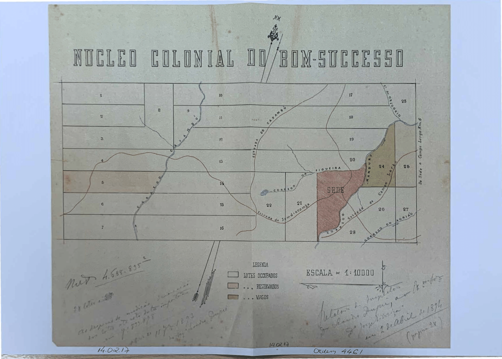

  

### Engineering Belonging: The Unequal Legacies of Migration Policy for Democracy in the Southern Cone

Across the late nineteenth and early twentieth centuries, governments throughout Latin America used migration policy to engineer national populations. States did not simply seek to attract labor or increase population. Through land grants, subsidies, preferential access to economic opportunities, and naturalization rules, political elites sought to attract migrants they considered desirable and reshape the ethnic and racial composition of the nation (González Bernaldo de Quirós 2024; Holloway 1980; McNamee 2023; Sánchez-Alonso 2019; Skidmore 1990). Brazil, Argentina, and Uruguay were central sites of these projects, where European migration became intertwined with efforts to develop frontier regions, consolidate territorial control, and construct national identities. Yet we know much less about the legacies these projects left behind. My book, Engineering Belonging, takes this gap as a starting point and investigates how demographic engineering shaped the political and social orders that subsequent generations inherited. I argue that these policies generated both material and symbolic inequalities by distributing assets, opportunities, status, and political membership along hierarchical lines. These inequalities could persist long after the original policies disappeared, shaping contemporary political attitudes and institutions. The book therefore asks how demographic engineering continues to shape two fundamental questions of democratic politics: who gets what and who belongs

The theoretical framework builds on the idea that settlement policies are not neutral instruments of state development. By determining which migrants were welcomed, where they settled, and how they gained access to land and economic opportunities, these policies shaped the material foundations of the societies they helped construct. They could also give social meaning to differences between groups, associating particular populations with desirable qualities such as civilization, modernity, or national belonging. These symbolic distinctions do not always produce a clear hierarchy. Ethnic and racial identities can distinguish groups without necessarily creating a hierarchy, but they can also become hierarchical, with some groups understood as more desirable, more modern, or more fully belonging than others. The distinction between ranked and unranked identities helps capture this variation in the symbolic legacies of demographic engineering (Lee 2020). In this way, settlement policies can shape not only the distribution of resources but also the status attached to different groups, with both material and symbolic consequences transmitted across generations.

The book brings together literatures that have largely developed separately. Research on migration and democracy has examined how migration shapes political institutions, representation, and the boundaries of democratic inclusion (Auerbach and Thachil 2023; Charnysh 2024; Dancygier 2017). Research on race and nation in Latin America has shown how racial categories and national identities were constructed through state projects, including in Brazil and Argentina (Alberto and Elena 2016; Appelbaum 2003; Nobles 2000; Weinstein 2015). Research on intergenerational mobility and political persistence shows that the consequences of migration, institutions, beliefs, and social identities can extend across generations (Abramitzky, L. Boustan, et al. 2021; Abramitzky, L. P. Boustan, and Eriksson 2014; Acharya et al. 2018; Jennings 2007; Lindgren and Oskarsson 2023; Lupu and Peisakhin 2017). Recent work further links ethnoracial hierarchy to democratic commitments (Morgan and Kelly 2025; Suryanarayan 2019). Rather than treating the consequences of migration primarily as demographic or economic, I show how migration policy can become a source of durable political inequality by shaping both material resources and the meaning of belonging. I also build on work showing that institutions can shape relations across ethnic groups through channels beyond extraction and economic competition (Jha 2013). The book’s comparative design makes it possible to distinguish between historical ancestry as a source of social identification and ancestry as a politically meaningful hierarchy, connecting the study of migration and demographic change to broader questions about democratic membership and political equality.